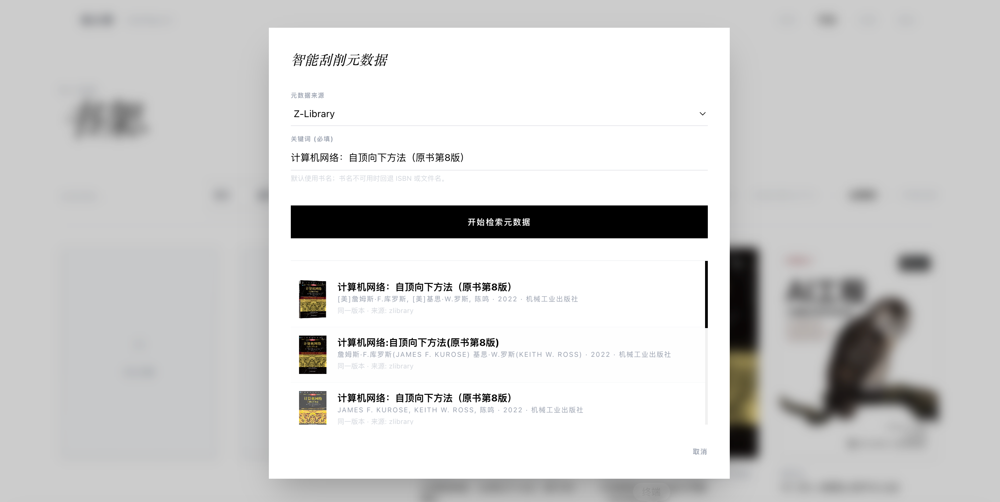

# ReadEveryWhere

面向个人读者的电子书资产管理与阅读平台。前端使用 Vue 3，后端使用 NestJS 11 和 SQLite；`packages/epub-core` 提供前后端共享的 EPUB 解析、定位与关键词索引能力。

## 功能

- 书库管理、本地导入、元数据补全与阅读画像
- EPUB / PDF 阅读、批注、书签和跨设备阅读进度同步
- 基于服务端会话与 HttpOnly Cookie 的网页登录
- AI 阅读任务，以及基于书内关键词检索和可回放证据的选区问答

## 代码结构

- `frontend/src/`：Vue 页面、阅读器及业务功能
- `backend/myapp/`：NestJS 模块、SQLite 持久化、HTTP 接口与测试
- `backend/reader-tools-mcp/`：本地阅读工具适配器
- `packages/epub-core/`：共享 EPUB 核心
- [`docs/接口文档/`](docs/接口文档/README.md)：对外 HTTP 契约

## 公开版本边界

本仓库由私有工作仓库的已跟踪代码生成。Zlibrary 与 Douban 外部数据源 Provider 的具体上游请求、认证与解析实现没有公开；相应直连测试也已排除。业务接口和 Port 保留，公开版组合根使用空书源注册表。外部书源功能不可直接运行，应用启动所需的外部 Provider 绑定也未补齐；其余代码可独立阅读和构建验证。

仓库不含运行数据、凭据或生产部署目录。`backend/Dockerfile` 仅作通用的本地构建示例。脱敏范围见 [`SANITIZATION.md`](SANITIZATION.md)。
